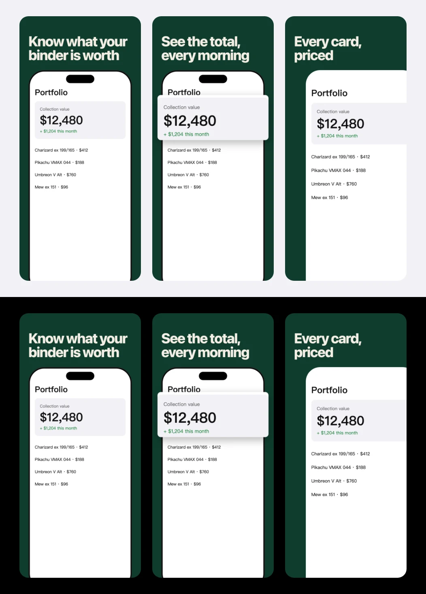
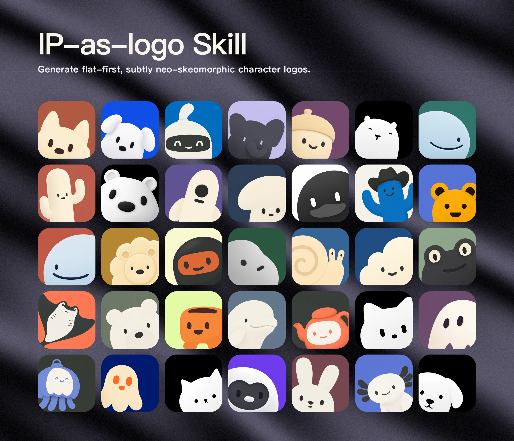
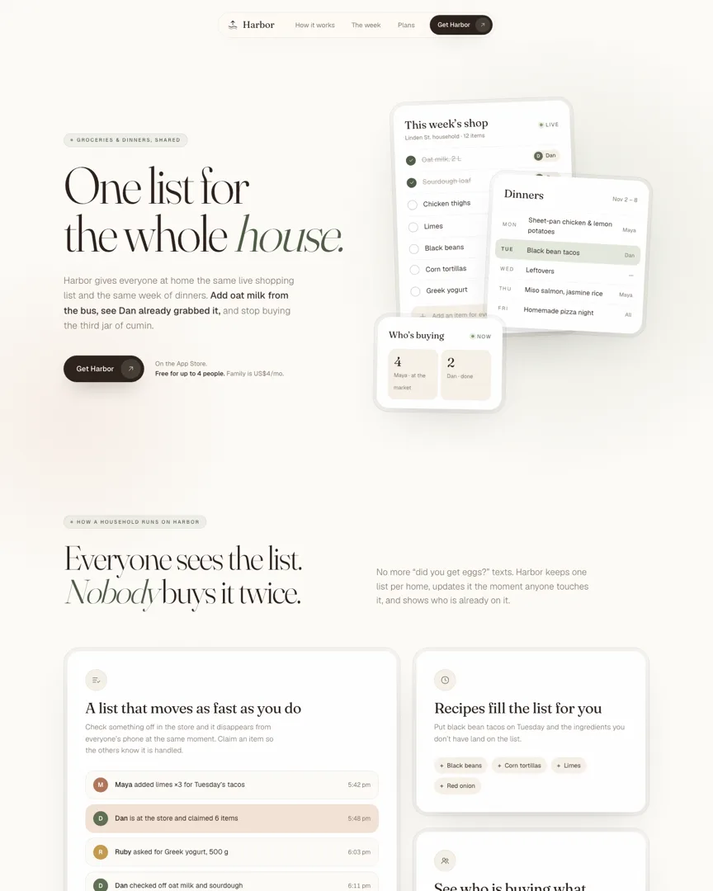
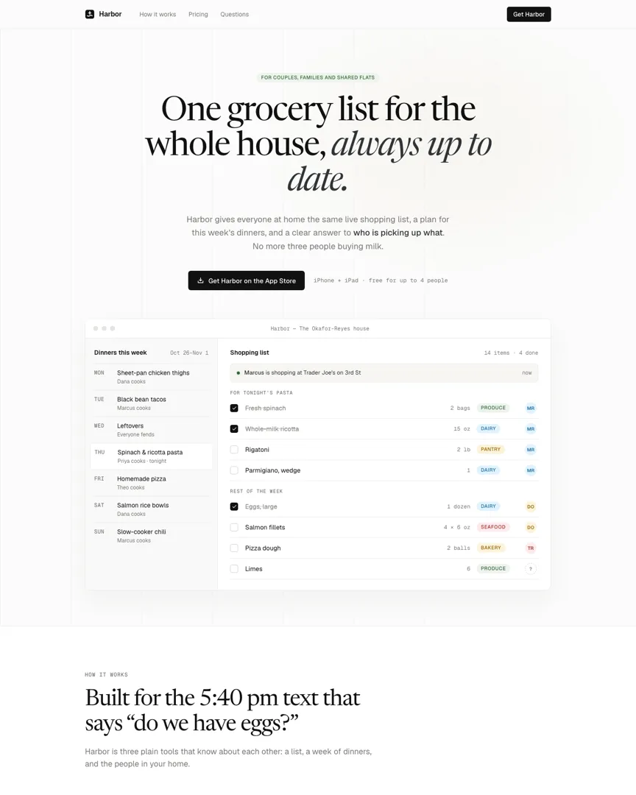
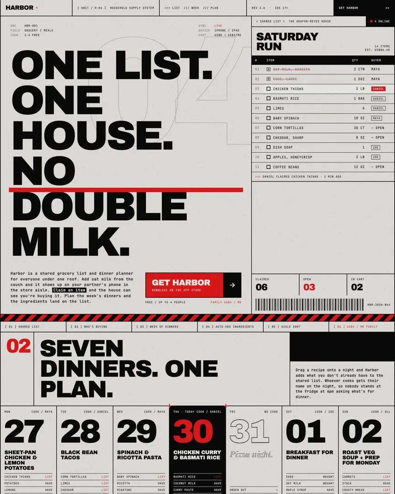
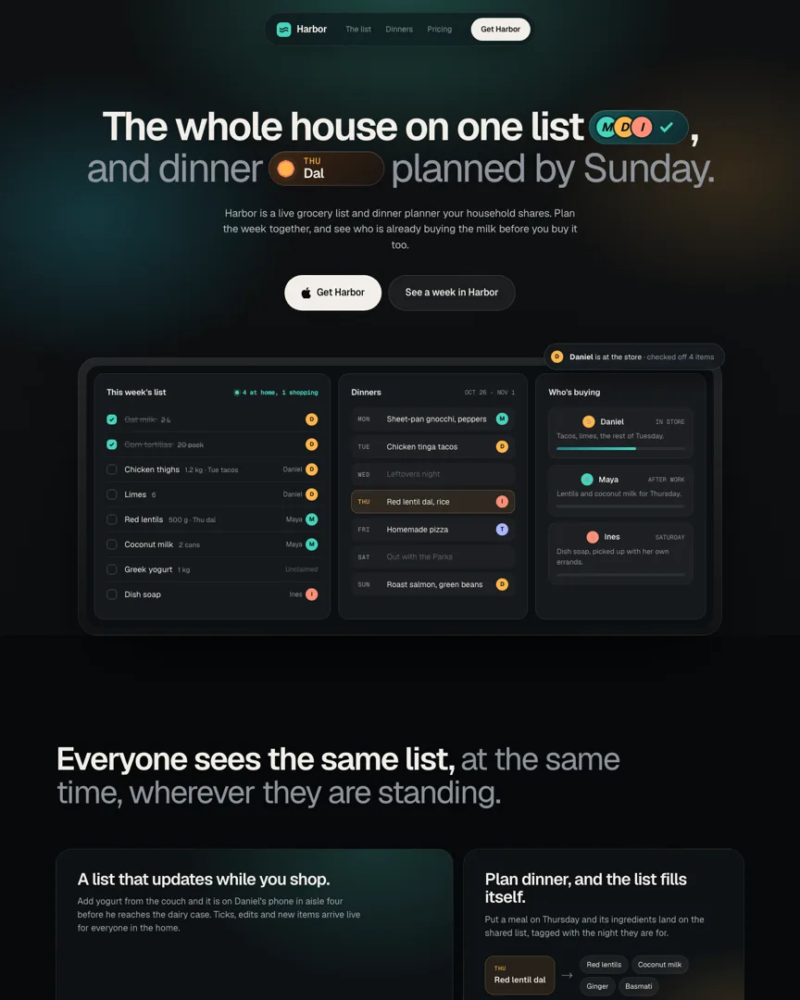
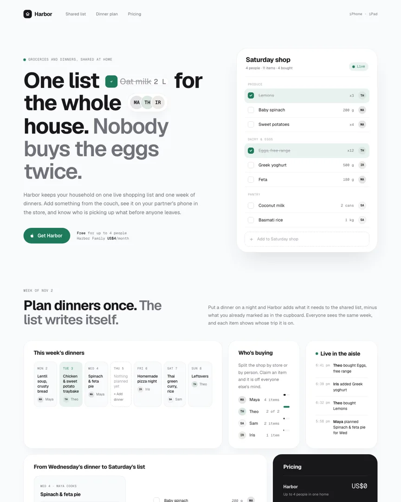
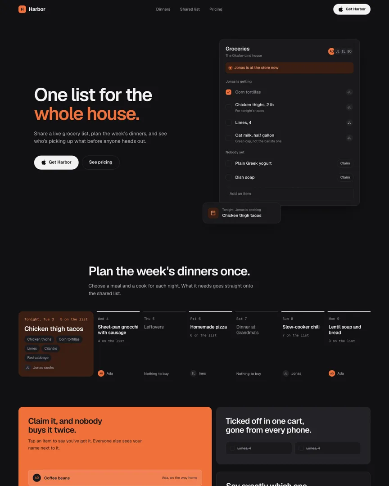
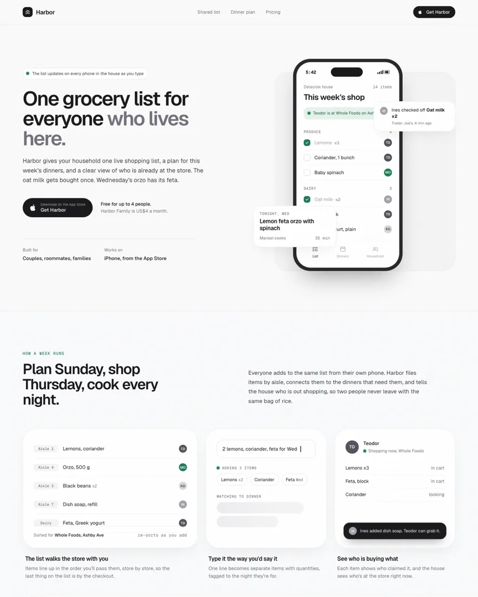

# SammyLin/skills

English · [繁體中文](README.zh-TW.md)

Agent skills I use and trust, in one place. Each lives in `skills/<name>/` with its own `SKILL.md`;
the folder name is the skill's name.

## My skills

Documented in English and Traditional Chinese; they answer in the language you write in.

| Skill | What it does | Origin |
| --- | --- | --- |
| [`store-screenshots`](skills/store-screenshots/) | App Store / Google Play screenshot sets: benefits found in the code, a storyboard you approve before anything renders, exact store sizes from real app screens, a gate and a critique. Localized. | Redesigned from [adamlyttleapps](https://github.com/adamlyttleapps/claude-skill-aso-appstore-screenshots) with ideas from [taste-skill](https://github.com/leonxlnx/taste-skill), [shots](https://github.com/hypersocialinc/shots), [store-screenshots](https://github.com/LeeHueeng/store-screenshots) |
| [`humanizer-zh`](skills/humanizer-zh/) | Takes the AI flavour out of Chinese text for Taiwanese readers: 49 patterns, full-width punctuation, mainland-term glossary, plus a mechanical checker. | Built on [nagameTW/formosa-humanizer](https://github.com/nagameTW/formosa-humanizer), MIT |
| [`grill-me`](skills/grill-me/) | Stress-tests a plan before you build: asks about major and medium decisions as pick-an-option questions, follows up on what each answer changes, decides only the small stuff, writes an ADR when one is earned. | Adapted from Matt Pocock's [`grill-with-docs`](https://github.com/mattpocock/skills), MIT |

### What they make

**store-screenshots**: the example set, as it appears in search results on light and dark (mock app).



## Vendored skills

Copied unchanged with their licences. The taste-skill classics are opt-in: they run only when
called by name (`/minimalist-ui`).

| Skill | What it does | Origin |
| --- | --- | --- |
| [`ip-as-logo`](skills/ip-as-logo/) | Extremely simple, cute mascot characters that work as a logo: three directions, six candidates, a dominant lower-left composition. | [s1dashu/ip-as-logo-skill](https://github.com/s1dashu/ip-as-logo-skill) |
| [`humanizer`](skills/humanizer/) | Removes signs of AI-generated writing from English text (Wikipedia's "Signs of AI writing"). | [blader/humanizer](https://github.com/blader/humanizer) |
| [`high-end-visual-design`](skills/high-end-visual-design/) | Calm, polished UI: soft contrast, whitespace, spring motion. | [taste-skill-classics](https://github.com/Leonxlnx/taste-skill-classics) |
| [`minimalist-ui`](skills/minimalist-ui/) | Editorial product UI with a restrained palette and crisp structure. | taste-skill-classics |
| [`industrial-brutalist-ui`](skills/industrial-brutalist-ui/) | Hard mechanical language: Swiss type, sharp contrast, experimental layout. | taste-skill-classics |
| [`gpt-taste`](skills/gpt-taste/) | A stricter variant for GPT and Codex: layout variance, AIDA structure, GSAP motion. | taste-skill-classics |
| [`stitch-design-taste`](skills/stitch-design-taste/) | Rules for Google Stitch, with an optional `DESIGN.md` export. | taste-skill-classics |
| [`design-taste-frontend-v2-experimental`](skills/design-taste-frontend-v2-experimental/) | The single-file, dial-driven taste-skill that was the default before v2. | taste-skill-classics |
| [`design-taste-frontend-v1`](skills/design-taste-frontend-v1/) | The original taste-skill. | taste-skill-classics |

### What they make

**ip-as-logo** (from the upstream repo):



**taste-skill classics**: the same brief (Harbor, a shared grocery and dinner-planning app) built
with each skill, top 1800px at 1440px wide. Pages made for this README, not by the upstream author.

<table>
<tr><td width="50%"><br><code>high-end-visual-design</code> · Calm, polished</td><td width="50%"><br><code>minimalist-ui</code> · Editorial minimal</td></tr>
<tr><td width="50%"><br><code>industrial-brutalist-ui</code> · Industrial brutalist</td><td width="50%"><br><code>gpt-taste</code> · GPT taste</td></tr>
<tr><td width="50%"><br><code>stitch-design-taste</code> · Stitch DESIGN.md</td><td width="50%"><br><code>design-taste-frontend-v2-experimental</code> · taste v2 experimental</td></tr>
<tr><td width="50%"><br><code>design-taste-frontend-v1</code> · taste v1</td></tr>
</table>

## Install

```bash
npx skills add SammyLin/skills --global                        # everything, every project
npx skills add SammyLin/skills -s store-screenshots --global   # one skill
npx skills add SammyLin/skills -l                              # list what's here
```

Or as a Claude Code plugin: `/plugin marketplace add SammyLin/skills`.

## Update

On each machine, after a push:

```bash
npx skills update -g
```

Edit skills in a clone of this repo, never in the installed copy; the next update overwrites it.

## Adding a skill

1. `skills/<name>/SKILL.md` with `name` and `description` frontmatter; the folder name equals `name`.
2. A row in the tables here and in `README.zh-TW.md`.
3. My own skill: a `README.md` and a `README.zh-TW.md`.
4. A skill that makes something visual: an example image in `docs/images/`, shown in both READMEs
   (images live outside `skills/` so installs stay small).
5. Someone else's skill: only if its licence allows it; keep its `LICENSE` in its folder and credit
   the origin.

## Licence

MIT (see `LICENSE`). Vendored skills keep their own licence in their folder.
