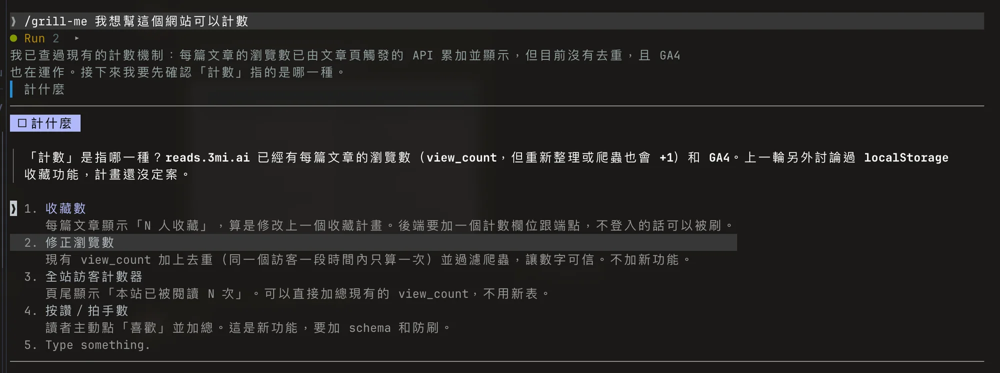

# grill-me

[English](README.md) · 繁體中文

開工前先把計畫拷問一遍。改寫自 Matt Pocock 的 [`grill-with-docs`](https://github.com/mattpocock/skills)：影響成品的事一樣都會問，但改成點選回答，小事直接幫你決定並列出來，而且每次你回答後，都會追問這個答案帶來的影響。

*實際的一輪：它先讀過程式碼（已經有瀏覽數，但沒有去重；GA4 也在跑），再問你「計數」指的是哪一種，每個選項都寫出代價。*

| | grill-with-docs | grill-me |
| --- | --- | --- |
| 問什麼 | 每個還沒定的決策，直到全部問完 | 先問重大的（難以回頭、影響使用者／金錢／安全、卡住其他決策、真的有分歧、前後矛盾），再問中等的（範圍、使用者會注意到的行為、有代價的取捨） |
| 小事 | 也都問 | 命名、檔案結構、內部程式結構、照現有設計走的樣式：直接給預設值並列出來 |
| 怎麼回答 | 每題自己打字回覆 | 在 Claude Code 的選擇題介面點選，推薦選項排第一（沒有介面時改用編號選項） |
| 每輪題數 | 當下能問的全部一起問 | 每輪最多四題；不限輪數，超過五輪會先問你要不要繼續 |
| 你回答之後 | 進到下一個分支 | 檢查這個答案帶出什麼：使用者的新代價、新的分支、不用做的部分，有就接著問 |
| 邊界情況 | 為了測試會主動編出來 | 會改變使用者看到的東西或要做的內容時才問 |
| 文件 | 每個術語都寫進術語表，必要時寫 ADR | 難以回頭的取捨才寫 ADR；術語表只收這次真的造成混淆的詞 |
| 結束 | 所有分支問完 | 一定先整理成「已決定、預設值、你接受的取捨、這版不做」四段，等你說好才開工 |

在 Claude Code 裡輸入 `/grill-me`，或直接說「幫我拷問這個計畫」。

MIT 授權。改寫自 Matt Pocock 的 skills（MIT），ADR 與術語表格式沿用原作。
