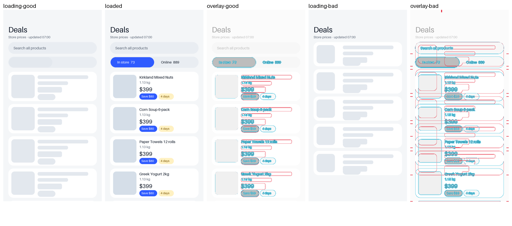

# mobile-layout-stability

English · [繁體中文](README.zh-TW.md)

Finds and fixes layout shift in a native iOS (SwiftUI) or Android (Compose) app: skeletons that
don't match the loaded screen, photos and prices that push rows when they arrive, controls that
appear late, lists that jump on refresh, lost scroll positions. It walks every screen, not just
the one in the bug report, and fixes the cause instead of covering it with animation.

It proves the fix on a simulator: a debug flag holds every request in loading, and
`shift_check.py` compares the loading and loaded screenshots and lists every card, photo block
or control that moved.

Use it in Claude Code: `/mobile-layout-stability`, or say "the list jumps when it loads".

MIT.
