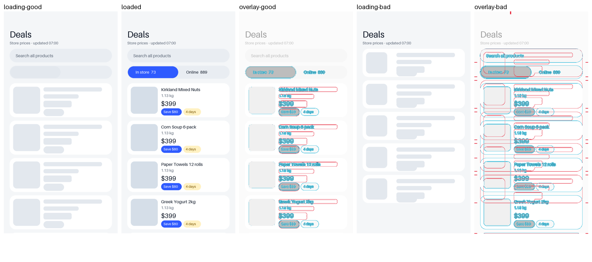

# mobile-layout-stability

[English](README.md) · 繁體中文

找出並修好原生 iOS（SwiftUI）或 Android（Compose）App 的畫面跳動：skeleton 和載入後的畫面不一樣、圖片和價格到了把整列推開、控制項晚出現、清單重新整理時跳、捲動位置跑掉。它會把每個畫面都走一遍，不只修回報的那一個，而且修原因，不用動畫蓋過去。

修好之後在模擬器上證明：用 debug 參數讓所有請求停在載入中，`shift_check.py` 比對載入中和載入完成兩張截圖，列出每張移動了的卡片、圖片區塊和控制項。

在 Claude Code 裡用 `/mobile-layout-stability`，或直接說「清單載入時會跳」。

MIT。
